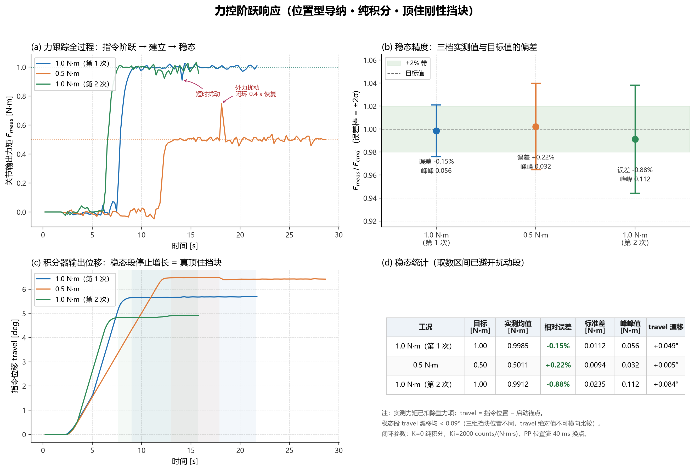

# 力控精度测试汇总

**日期**：2026-11-07  
**对象**：MXBS-14 关节模组（CANopen CiA402，PP 位置模式）+ XJC-NJ70-25N·M 力矩传感器  
**控制方法**：位置型导纳，刚度 K = 0 退化为纯积分力环

---

## 1. 实验条件

| 项         | 值                                             |
| --------- | --------------------------------------------- |
| 控制律       | `pos_cmd = pos_ref + Ki·∫(F_cmd − F_meas) dt` |
| 积分增益 `Ki` | 2000 counts/(N·m·s)                           |
| 位置输出方式    | PP 轮廓位置模式，40 ms 换点（25 Hz）                     |
| 位置反馈      | TPDO1 定时 2 ms（`0x6041` `0x6064`）              |
| 力矩传感器     | RS485 20 Hz 轮询，一阶低通 α = 0.7（τ = 41.5 ms）      |
| 力环总延迟     | 约 162 ms（轮询 30 + 低通 41.5 + 驱动器 71 + 换点量化 20）  |
| 负载        | **刚性挡块**（固定止挡，刚度远大于 1.47 N·m/deg）             |
| 采样        | 100 Hz 递推，200 ms 打印一次                         |


---

## 2. 结果

三档指令，三次独立实验（挡块位置与启动锚点各不相同）。

| 工况             | 目标 F_cmd | 稳态均值 F_meas | **相对误差**   | 标准差    | 峰峰值       | 稳态 travel 漂移     |
| -------------- | -------- | ----------- | ---------- | ------ | --------- | ---------------- |
| 1.0 N·m（第 1 次） | 1.00     | 0.9985      | **−0.15%** | 0.0112 | 0.056     | +0.049° / 12.8 s |
| 0.5 N·m        | 0.50     | 0.5011      | **+0.22%** | 0.0094 | **0.032** | +0.005° / 4.8 s  |
| 1.0 N·m（第 2 次） | 1.00     | 0.9912      | **−0.88%** | 0.0235 | 0.112     | +0.084° / 8.3 s  |

> 稳态均值取指令建立后、松手前的连续采样段；两次外部扰动（14.1 s、18.1 s）已从统计中剔除，  
> 扰动本身闭环在 0.4 s 内自行恢复。

### 动态指标

| 指标           | 实测                                            |
| ------------ | --------------------------------------------- |
| 自由空间接近速度     | 4000 ~ 4035 counts/s（理论 `Ki × F_cmd`，误差 < 1%） |
| 力建立时间（到 90%） | 约 2.0 s                                       |
| 超调           | 0 ~ 5%（1.0 N·m 峰值 1.011 N·m）                  |
| 单拍位置指令最大跳变   | 11 ~ 21 counts（限幅 130）                        |
| 通信           | 换点 265 / 510 / 215 次，失败 0                     |

---

## 3. 说明

- **稳态 `err` 接近 0 是正常现象**。PP 模式的位置环输出速度指令、速度环 PI 的积分项在零速稳态下维持转矩，  
  所以力不需要靠位置越界来产生。判断"是否真顶住"要看**积分器输出位移 travel 是否停止增长**  
  （上表最后一列，13 秒内只涨 0.056°），而不是看位置误差。
- 位置型力控的稳态位移由目标力与环境刚度决定：`F_cmd / k_env`。本平台 `k_env ≈ 1.47 N·m/deg`，  
  1.0 N·m 对应约 0.68° 的抵入量。
- 力环带宽约 0.32 Hz（`Ki × k_env = 2 rad/s`），相角裕度约 72°，因此响应时间为秒级，属正常。

---

## 4. 图



- **(a)** 力跟踪全过程：指令阶跃 → 建立 → 稳态，虚点为各档目标
- **(b)** 稳态精度：实测均值与目标值的偏差，误差棒 = ±2σ
- **(c)** 积分器输出位移：稳态段停止增长，说明臂被挡块限住而非继续推进
- **(d)** 稳态统计表

---

## 5. 复现

```bash
cd 力控实验数据
python plot_fc.py fc_rigid_20261107.txt
```

- `fc_rigid_20261107.txt` — 串口原始日志（三段实验拼在一个文件里，按 `[ADM] ===== 力控模式启动` 自动分组）
- 换新数据只需改脚本顶部 `STEADY`（稳态取数区间）、`NAMES`（图例）、`EXCLUDE`（剔除扰动的时窗）
